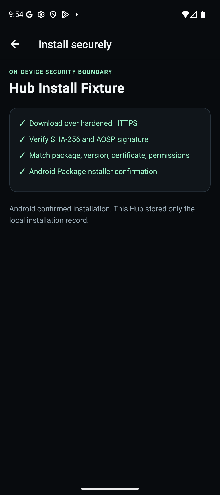

# Android vertical slice — API 36 evidence

## Result

Passed on 2026-08-07 using the Pixel 9 API 36 emulator (`emulator-5554`) and the real Android system installer. No native or backend step in the install/update path was mocked.

The verified sequence was:

1. Local Supabase served the consented, allowlisted App and v1 Release as `development_preview`.
2. The standalone Hub APK rendered the Release from the real catalogue API.
3. Android's app-specific unknown-sources screen granted install capability to the Hub.
4. Kotlin downloaded `v1.apk` over HTTPS and verified its byte length, SHA-256, AOSP APK signature, package, version, minSdk, permission set, and current signer.
5. `PackageInstaller.Session` opened Android's confirmation UI. Play Protect scanned the test APK and Android installed it.
6. `dumpsys package com.lololabs.hubfixture` reported version code 1 and version name 1.0.0.
7. The seed transition exposed v2. The Hub's local SQLite record plus targeted package inspection reported `Update available: v2.0.0 (2)`.
8. The Kotlin preflight accepted the same signer and higher version. Android displayed `Do you want to update this app?`.
9. Android completed the update. `dumpsys` reported version code 2, version name 2.0.0, and an unchanged first-install timestamp.

Final installed state:

```text
package=com.lololabs.hubfixture
versionCode=2
versionName=2.0.0
minSdk=26
targetSdk=36
firstInstallTime=2026-08-07 21:37:24
lastUpdateTime=2026-08-07 21:46:03
```



## Fixed fixture identities

| Artifact | SHA-256 | Package/version | Certificate SHA-256 |
|---|---|---|---|
| v1 | `8e50cee640062ba1bfcfb7c3bcae7afbf33dd803e4c26219a132387b8ebf5160` | `com.lololabs.hubfixture` / 1 | `ad3ab6f4878a16a91ccc0572d3a96248cf2c50ad195187209dcc9a7814c716ef` |
| v2 | `5c88eeb5b4eace009f859058c4c5fadfeb3f1695c78a135e48f3a53d2afb4653` | `com.lololabs.hubfixture` / 2 | `ad3ab6f4878a16a91ccc0572d3a96248cf2c50ad195187209dcc9a7814c716ef` |
| wrong package | `374c8ad17eec96dae743cf4d0badd2e7edc8f1d0f6bc4e64e20688d76f5758b4` | different package | fixture certificate |
| wrong certificate | `4c0ba5fdea5888e180b968435be608b26bfa6879f3e17b9cd6f9abed8ebcccab` | expected package | `1ba54468327f92d1e3f90d419e4f4c333a2fe07d754237932e4552615d37f4be` |

The checked-in manifest in `fixtures/apks/hub-test-app/artifacts/manifest.json` remains the machine-readable source.

## Security assertions

- The merged debug APK requested `REQUEST_INSTALL_PACKAGES` and did not request `QUERY_ALL_PACKAGES`.
- The only exact package query is the fixed internal fixture `com.lololabs.hubfixture`.
- JavaScript never provides a file path to PackageInstaller; it can submit only a native opaque prepared ID.
- The prepared file is rehashed and re-inspected immediately before session submission.
- Native unit tests block package, version, minSdk, permission, certificate, installed-edition, and downgrade mismatches.
- A user cancellation or PackageInstaller conflict never triggers an uninstall.
- Only the Hub's own successful installation records are kept in SQLite; no installed-app inventory is uploaded.

Mobile MCP was unavailable in the active connector set, so the equivalent real-device control path used explicit ADB targeting. The physically connected Seeker was not modified.

## Production PrivacySafe installation — 2026-10-12

Passed on the physically connected Seeker running Android API 36, using Dapport's production catalogue and Android's system installer. The device owner confirmed that PrivacySafe installed successfully; Dapport displayed `PrivacySafe is installed.`

- Dapport was updated in place from 0.5.6 (13) to the signed production 0.5.7 (14) APK using `adb install -r`. Its first-install timestamp remained `2026-08-11 12:16:32`, confirming the existing installation was preserved.
- PrivacySafe was downloaded and installed through Dapport, rather than installed directly through ADB. Android reported `installerPackageName=com.lololabs.solanaandroidhub`, package `app.privacysafe`, version `26.10-0.21.19.6` (12610006), minSdk 29 and targetSdk 36.
- The previous failure was reproduced with Dapport 0.5.6: Android's implicit photo-selection permission caused `APK_PERMISSIONS_MISMATCH` despite a valid, matching APK. The fix excludes only permissions marked implicit by Android API 34 or newer; explicit and unknown extra permissions remain blocked.
- Native error codes now survive the JavaScript error mapping, so a rejected APK produces a useful explanation instead of the generic preparation error.
- All 50 mobile tests, 14 native policy tests, lint and TypeScript checks passed. GitHub CI run `38236154990` passed both the repository check and Android native jobs for source commit `d363282e99549db32402640a83c43b2e1fc9b5a8691b8b`.

Tested production artifact:

```text
file=Dapport-v0.5.7.apk
package=com.lololabs.solanaandroidhub
versionName=0.5.7
versionCode=14
bytes=112960567
sha256=0B932B198FDBBD49A3613C13AF1ED79B60BA948DB2D4B2BAE406A5B9157625CA
certificateSha256=02F204B9CBED11E59F85B2A6DBCB34AD6F0A4658C639D58B2C27FB3BE2AD0E09
```

The physical acceptance covers PrivacySafe's installation through Dapport and Dapport's in-place signed update. It does not establish PrivacySafe's messaging behavior or Dapport's self-update UI flow. The existing dedicated installation screen remains unchanged by this release.

## Inline installation and library reconciliation — 2026-10-12

Passed on the same physical Seeker (Android API 36), using the signed production Dapport 0.5.9 (16) APK. Source commit: `8f7e0662eef0b36a042b5e51f7f10c87cda68769`.

- Dapport was updated in place using `adb install -r`; its first-install timestamp stayed `2026-08-11 12:16:32`.
- PrivacySafe, installed through Dapport during the preceding installation acceptance, remained installed at version `26.10-0.21.19.6` (12610006). Its detail page showed `Installed` and `Open`; tapping `Open` launched the real `app.privacysafe` application. Library showed its actual app icon and current version.
- RivalCrest was absent from Android, despite an old local installation record. The catalogue now showed `Install`, and Library excluded the unconfirmed record. A new 482 MB download started on the detail page, displayed progress and `Cancel`, and cancellation returned the action to `Install` without an Android installation prompt. Returning to the catalogue, Library, and Dapport after the Android home screen preserved the correct state: RivalCrest was absent from Library and PrivacySafe remained installed. `pm path com.tosh.clashroyallike` confirmed RivalCrest was absent after cancellation.
- Ivy Cyber's profile opened from PrivacySafe inside Dapport's native activity, with avatar, bio, optional links, and its PrivacySafe card marked `Installed`. The share button opened Android's share sheet with `https://dapport.app/publishers/ivycyber`; the sheet was dismissed without sharing.
- All 67 mobile tests, mobile lint/typecheck, 14 native policy tests, signature verification and 16 KiB ZIP alignment checks passed. GitHub CI run `38247617948` passed both jobs for the source commit above.

The shared library/catalogue projection requires current Android confirmation before displaying `Installed` or `Update`. It uses Android's current version, preserves SQLite permission history, and refreshes on screen focus and return to the foreground. An unknown package-visibility result is never converted into proof of absence or a destructive history deletion. Cancelling an update preserves the previously installed version; this branch is covered by the controller and projection regression tests.

Tested production artifact:

```text
file=Dapport-v0.5.9.apk
package=com.lololabs.solanaandroidhub
versionName=0.5.9
versionCode=16
bytes=113123983
sha256=94E9DE7251E697F2E1E995D8220CF9DC9F893F61A8010DCEF84F4857C940AD2C
certificateSha256=02F204B9CBED11E59F85B2A6DBCB34AD6F0A4658C639D58B2C27FB3BE2AD0E09
```

The public GitHub APK was downloaded again and matched these exact bytes and SHA-256. This acceptance does not cover PrivacySafe messaging, a physical cancellation of an already-installed app's update, or Dapport's self-update UI; Dapport's in-place upgrade was performed through ADB.
